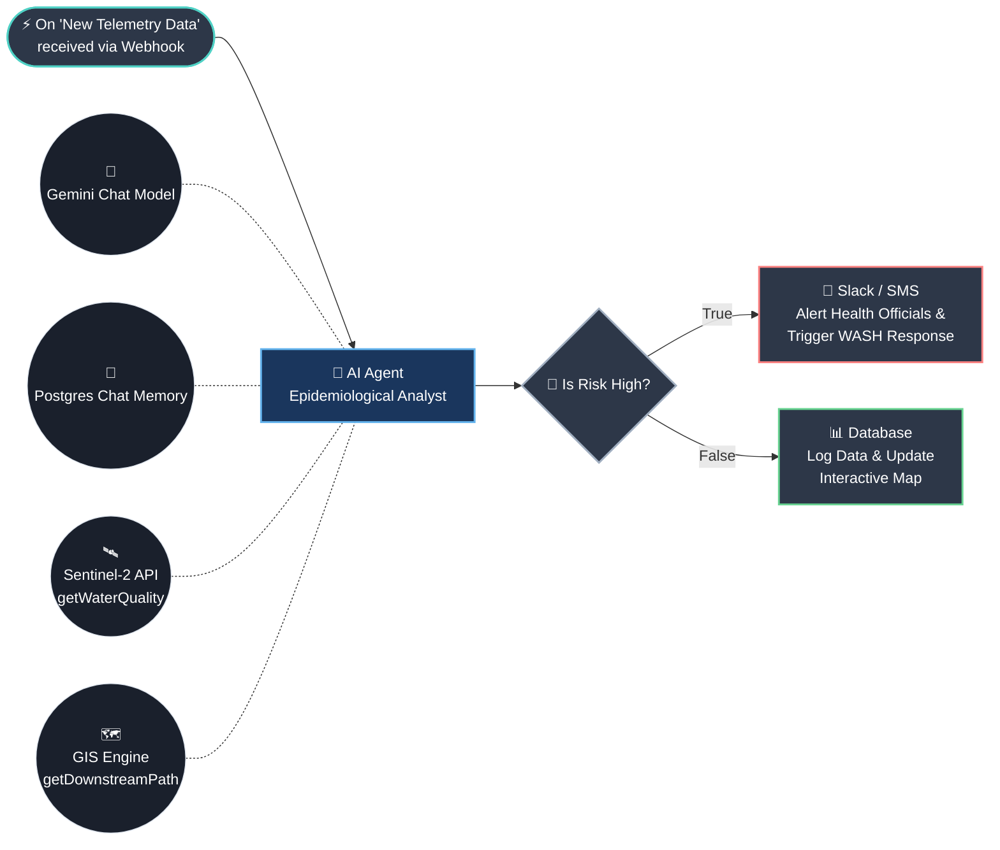

# AI Agent Automation Workflow (JalDrishti)

Based on the node-based visual workflow builder paradigm, here is how the automation for the **Spaceborne Waterborne Outbreak Observatory** would be structured using an AI Agent flow (e.g., using LangChain, Flowise, n8n, or similar frameworks).

## Visual Workflow Diagram

## Step-by-Step Breakdown

### 1. Trigger Node (The Input)
* **Action:** The workflow is triggered automatically when new environmental data (e.g., Turbidity, Rainfall, Temperature) is submitted either via an automated satellite webhook or a field-worker submitting a form.

### 2. AI Agent Node (The Brain)
* **Core Task:** The AI Agent receives the new data and analyzes it to determine the probability of a waterborne outbreak.
* **Connections:**
  * **Chat Model:** Powered by an LLM (like Google Gemini) to understand context and reason through the data.
  * **Memory:** Connects to a Postgres database to remember past outbreaks and historical trends in that specific district.
  * **Tools:** The agent is equipped with specific tools it can call:
    * *Sentinel-2 API:* To fetch the latest chlorophyll and turbidity indices.
    * *GIS Engine:* To calculate which districts are downstream from the contaminated site.

### 3. Logic Node (The Decision)
* **Condition:** The Agent evaluates the findings and outputs a boolean or categorical decision: *Is the outbreak risk "High" or "Very High"?*

### 4. Action Nodes (The Output)
* **If True (High Risk):** The system branches out to emergency services. It integrates with communication APIs (like Slack, Twilio SMS, or Email) to instantly alert local health officials, advising them to initiate WASH (Water, Sanitation, and Hygiene) protocols.
* **If False (Low/Moderate Risk):** The system simply logs the new telemetry into the database and updates the React Interactive Map dashboard for routine monitoring.
